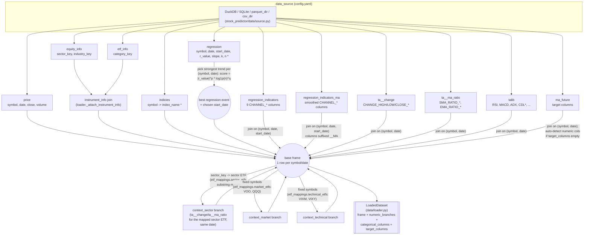
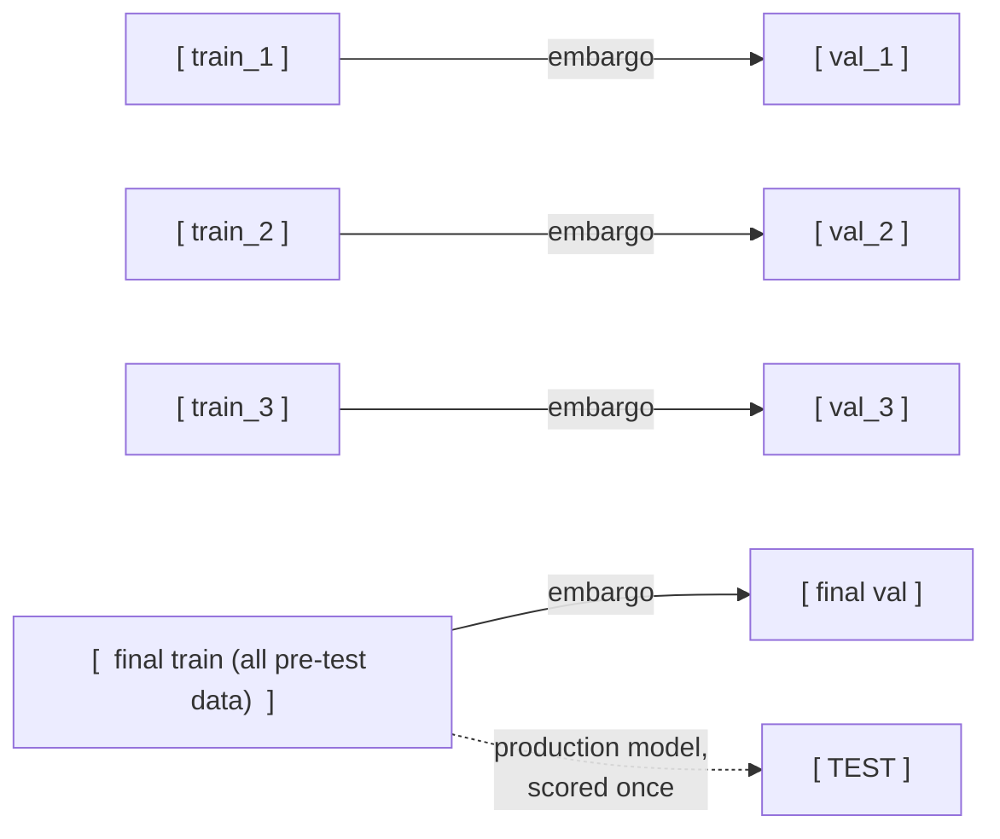
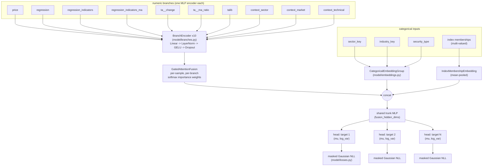
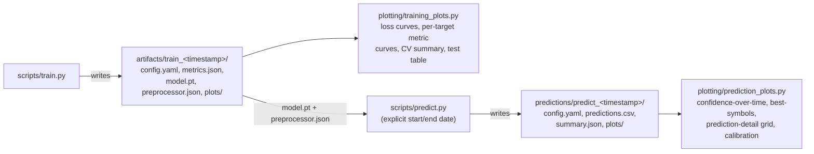

# Architecture

This document explains how every input table and config parameter flows
through the pipeline, and how the PyTorch model is put together. See
`README.md` for how to actually run things and `docs/REFERENCE.md` for
per-file/per-function documentation.

## 1. Data flow: from tables to model input

Every table listed here is configured in `config/config.yaml` under
`tables:` -- the column lists shown are the *default* config, but every one
of them can be edited without touching code (see `features/schema.py`).

`*` = the loader reduces a multi-row-per-symbol table down to one row per
`(symbol, date)` before it reaches the model: `indicies` is grouped into a
list of memberships per symbol, and `regression` is reduced to its single
strongest trend per `(symbol, date)`.

### Preprocessing (leakage-safe)

`features/preprocessing.py`'s `Preprocessor` is **fit fresh on each walk-
forward split's training rows only** (never on validation/test/future
rows): numeric columns are standardized (mean/std from that split's
training data, clipped to `preprocessing.clip_std`), categorical columns
(`sector_key`, `industry_key`, `security_type`, index memberships) are
mapped to integer ids via a vocabulary with a `min_category_freq` cutoff,
and `ma_future` targets are standardized the same way, with a separate
mask marking which labels are actually observed.

## 2. Time-series splitting

Each split's training window **expands** (rather than a fixed rolling
window) so the model sees progressively more market history across splits
-- this is what the project spec calls training on "multiple splits of
previous data to reduce the effect of broader market trends". An
`embargo_days` gap is removed immediately before every validation/test
block so that no training row's forward-looking `ma_future` label overlaps
a later block's feature dates (`splits/time_series_split.py`).

The `n_splits` CV splits measure how consistently the architecture/
hyperparameters generalize across different historical regimes. The
**final split** (`WalkForwardSplitter.final_split`) then fits the actual
production model on *all* pre-test history, which is the model scored on
the held-out test block and used for `scripts/predict.py`.

## 3. Model architecture

**Why a multi-branch tabular network instead of a raw sequence model
(RNN/Transformer over price history)?** The source tables already encode
history as engineered features as of each date -- `ta__change` is
literally a set of fixed-horizon lagged returns (1, 2, 3, ..., 200 days
back), and `regression`/`regression_indicators` already summarize a whole
trend window as slope/R/n/channel-position. Re-deriving that signal from
raw price sequences would add real architectural complexity (variable-
length windows, padding, positional encoding) for little expected benefit
given the features already available. Each table instead gets its own
small encoder ("branch"), branches are combined with a gated-attention
layer (so the model can learn to down-weight a branch that's missing or
uninformative for a given row -- e.g. a symbol with no qualifying
regression trend that day), and the fused representation feeds a shared
trunk and one small head per `ma_future` target.

**Why per-target `(mu, log_var)` heads?** Each target is optimized with a
masked Gaussian negative-log-likelihood loss (`model/losses.py`), which
lets the model learn *how confident* to be about each prediction as well
as the prediction itself -- `exp(0.5 * log_var)` becomes the predicted
sigma used throughout `plotting/prediction_plots.py` and
`inference/predict.py`'s `{target}__confidence` column.

## 4. Config -> code map

| Config section | Consumed by |
| --- | --- |
| `data_source` | `data/source.py`, `data/loader.py` |
| `tables.*` | `features/schema.py` (column resolution), `data/loader.py` (joins) |
| `etf_mappings` | `data/loader.py::_attach_etf_context` |
| `regression_selection` | `data/loader.py::_attach_regression` |
| `preprocessing` | `features/preprocessing.py` |
| `splitting` | `splits/time_series_split.py` |
| `model` | `model/architecture.py` |
| `training` | `training/trainer.py` |
| `project` | `utils/io.py` (run folder locations) |

## 5. Prediction and plotting flow

